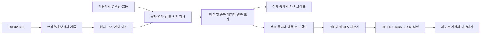

# 구조와 데이터 흐름

## 센서와 BLE

발당 ESP32 1개, FSR 앞·뒤 2개, MPU6500 1개를 사용한다. MPU 자세 필터는 펌웨어에서 수행하고 웹은 자세각과 두 ADC를 수신한다. 양발 구분은 웹 장치 등록에 속하며 펌웨어 패킷에는 발 식별자가 없다.

- 이름: `FSR-MPU-ESP32`
- 서비스: `d39b0001-96f8-4ed4-9b8c-bb981c31b001`
- 알림 특성: `d39b0002-96f8-4ed4-9b8c-bb981c31b001`
- 약 20Hz, 18바이트, little-endian

| 바이트 위치 | 형식 | 의미 |
|---|---|---|
| 0 / 1 | uint8 / uint8 | 버전 1 / IMU 상태 0 오류·1 보정·2 준비 |
| 2 / 4 | uint16 / uint32 | 순번 / ESP uptime ms |
| 8 / 10 | uint16 / uint16 | 앞 FSR / 뒤 FSR ADC |
| 12 / 14 / 16 | int16 | 롤 / 피치 / 요, 각각 각도 ×100 |

## 실행 모드

| 모드 | 웹/API | 기록 위치 | OpenAI 호출 |
|---|---|---|---|
| Vercel | 정적 웹 + Node 함수 | 브라우저 IndexedDB | `api/ai-analyze.mjs` |
| `npm run dev` | 같은 빌드의 로컬 Node 서버 | 브라우저 IndexedDB | 같은 Node 함수 |
| `python server.py` | Python HTTP·저장 API | 로컬 SQLite | 제공하지 않음 |

Vercel·Node 모드에서는 `web/browser-store.mjs`가 `/api/state`, `/api/trials`, `/api/platform` 등을 **브라우저 내부 fetch 인터페이스**로 처리한다. 외부 프로그램에서 같은 URL을 HTTP로 직접 호출하면 기록이 조회되지 않는다. `/api/ai-analyze`만 실제 서버 호출이다.

## CSV 분석 경로

`dist/csv-analysis.mjs`는 공유 파서·정제·통계·AI 입력 생성을 담당한다. `dist/csv-report-ui.mjs`는 주기 정규화 대신 시간 파형과 통계를 보여 준다. `dist/research.mjs`는 선택·업로드·AI 요청·저장·이전 보고서 호환을 연결한다.

빈칸은 null, 실제 0은 0으로 구별한다. 동일 발·동일 시각은 중복으로 정리하고 시간 역순을 정렬한다. 긴 공백과 채널 결측은 보충하지 않는다. 일부 채널만 유효한 행은 해당 채널의 분석에 사용할 수 있다. 발 구분이나 시각·모든 센서값을 읽을 수 없는 행은 제외하며 정제 요약에 반영한다. 정제는 측정 오류의 원인을 확정하거나 원본의 완전성을 보장하는 작업이 아니다.

AI 입력에는 전체 통계와 숫자 CSV를 사용한다. 3,000행을 넘는 긴 기록은 시간 간격을 넓힌 대표 행을 보내며 전체 행 수·전송 행 수·추출 간격을 공개한다. 대표 행의 간격을 원 신호 누락이나 정확한 보행 주기로 해석하지 않도록 모델에 지시한다.

## 자동 생성과 저장

`dist/app.mjs`가 Trial 저장에 성공한 뒤 `earlybird:trial-saved`를 보낸다. `dist/auto-report-ui.mjs`가 CSV 보고서 초안을 보관하고 `dist/auto-report.mjs` 큐가 AI 호출과 완성본 저장을 순서대로 처리한다. 자동 보고서 ID는 참여자·Trial에 고정된다. 저장 실패 후 AI 답변이 남아 있으면 재시도에서 답변을 재사용한다.

브라우저가 닫히면 처리하지 않는다. 대기 초안은 저장소에 남고 다시 코드·전송 동의를 설정한 뒤 이어갈 수 있다. 두 탭이 같은 기록을 동시에 처리하는 상황에 대한 분산 잠금은 제공하지 않는다. 원시 기록은 AI 오류와 별도로 보관한다.

## AI와 공개 경계

- `OPENAI_API_KEY`는 서버 환경에만 존재한다. 별도 이용 코드를 해시 비교해 요청을 제한한다.
- 정제 CSV를 서버에서 다시 숫자로 검사한다. CSV·질문은 시스템 지시를 바꾸는 명령으로 취급하지 않는다.
- `store:false`, 구조화 JSON, 다섯 설명 항목, `pd_probability:null`, 55초 제한을 사용한다.
- 간단한 분당 제한은 함수 인스턴스별이다. 대규모 공개 운영의 사용자 인증·분산 요청 제한은 별도 작업이다.
- 원시 가속도·각속도·체중 보정 힘·정확한 양발 지지시간·질병 확률은 현재 입력에서 확보되지 않는다.

## 파일 수정 위치

| 변경 | 소스 | 관련 검사 |
|---|---|---|
| BLE·보정 | `dist/protocol.mjs`, `dist/analysis.mjs`, `dist/app.mjs` | protocol·analysis 단위 검사 |
| CSV 정제 | `dist/csv-analysis.mjs` | CSV 단위·브라우저 검사 |
| 그래프·리포트 | `dist/csv-report-ui.mjs`, `dist/research.mjs` | CSV 브라우저 검사 |
| AI 서버 | `api/ai-analyze.mjs` | research·CSV 단위 검사 |
| 브라우저 저장 | `web/browser-store.mjs` | CSV 브라우저 검사 |
| Python 저장 | `storage.py`, `platform_store.py` | Python API 검사 |
| 배포 생성 | `scripts/build_vercel.py` | 빌드·공개 파일 검사 |

`vercel_site`는 다시 생성할 수 있는 결과물이다. 소스와 실행 데이터의 혼합을 막기 위해 Git에서 제외한다.
